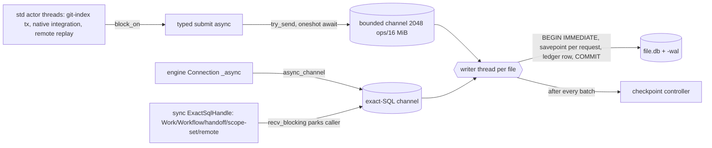

# TraceDecay storage layer, end to end

Tree: origin/master e5a8ede6ea (worktree agent-a9a062786c04623b1). Paths are relative to `crates/` unless absolute.
Sources: explorers 1 to 4 (`ground/explorer-*.md`), the #4099 growth enumeration, `/fast/tmp/arch-native-exec/ground-*.md`,
the drain lane's #4107 findings, and spot checks I ran for this document. `daemon/project_server_lifecycle.rs` was not read,
so the daemon's exact project-open sequence is inferred from its callers.

## Overview

TraceDecay keeps all durable state under one **profile root** (`$TRACEDECAY_DATA_DIR`, else `~/.tracedecay`). Inside it
there are three kinds of storage:

- **SQLite files** served by one in-process runtime. Each file gets one writer OS thread and a pool of reader OS threads.
  These are `global.db`, `user-sessions.db`, `user-memory.db`, `remote/nodes/*/remote.db`, and per project
  `projects/<id>/tracedecay.db` and `projects/<id>/sessions.db`.
- **Grafeo graph containers** (`*.grafeo` plus a WAL directory, and immutable sealed generations).
- **Flat-file stores**: code-index generations, spools, LCM payload files, response handles, JSONL logs, and locks.

One daemon per profile owns these files through a process-wide registry. CLI, doctor and hook processes can build their
own registry for the same files, and lock files keep them apart.

The layer is built for correctness at the row level: typed and idempotent writes, fail-closed ordering, and
reset-required instead of migration. It has almost no store-level mechanisms. Nothing bounds bytes. Retention covers a
minority of tables, and only on mounted stores. Nothing samples disk use periodically. Idle stores never checkpoint.
Every SQLite file costs at least 4 threads at rest. And one fault (a bad queue head, a WAL reader slot, a corrupt
container) freezes a whole file's worth of unrelated work.

Every incident of 2026-10-16 follows from one of these properties. The section "Incidents, by mechanism" maps them.
The closing inventory table is the input for the redesign.

## Key Concepts

- **Profile root / profile identity.** `ProfileRoot::from_env` (runtime-core `config.rs:78-112`). `profile-identity.json`
  holds `{brain_id, profile_id}`, and every shard id carries both (`store_locator_resolver.rs:254-259`).
- **Project id.** The id is `proj_` plus the first 16 hex chars of sha256 of the canonical *repository identity root*
  (`storage/layout.rs:80-127`). For a linked worktree whose common dir is `<repo>/.git`, that root is the primary
  checkout, so worktrees of one repository share one id. The repository marker
  `<git_common_dir>/tracedecay-project.json` takes precedence over minting (`layout.rs:198-222`).
- **Shard scope** (`StoreShardScopeV1`, tracedecay-store `runtime/identity.rs:116-152`): `Profile`, `ProfileSessions`,
  `ProfileMemory`, `RemoteNode`, `Project`, `ProjectSessions`, and `Code{Worktree|Branch|Snapshot}`. `Code` is a
  *namespace* inside the project Grafeo container, not a physical store. The resolver refuses it
  (`store_locator_resolver.rs:332-336`).
- **StoreRuntimeRegistry** (runtime-core `shard_runtime/registry.rs`). This process-wide singleflight map goes from
  `(shard_id, incarnation)` to a `ShardRuntime` plus a `RepositoryRuntimePhysicalAttachment` (one writer thread plus a
  reader pool). Clients hold a counted `StoreRuntimeClientLease`. `Database` (`db/connection.rs:62`) wraps a lease.
- **DaemonSessionRuntimeRegistryV1** (store-runtime `session_registry.rs:2661`). This is the "single owner of store,
  shard and session lifecycle". It owns the resolver, the kernel registry, the `GraphDbRegistry`, the profile owners,
  remote nodes, and `project_owners`.
- **RegisteredGlobalDb**. Despite the name, it wraps *every* registered SQLite file (global.db, user-sessions.db,
  user-memory.db, every sessions.db). All of them get one union schema of about 100 tables (global-db
  `schema_stages.rs:978-1186`).
- **Exact SQL vs typed protocol.** Writes reach the writer either as closed-enum `RuntimeSubmitRequestV1` payloads (15
  variants, `operation.rs:777-793`) or as arbitrary SQL through `ExactSqlHandle` behind an authorizer. Reads are typed
  `RuntimeReadRequestV1` or exact SQL.
- **Execution class.** Each caller decides whether it parks a thread waiting on a store. That decision is the main
  source of the native-worker stalls.

## How It Works

### 1. From a cwd to a file path

```
cwd ──discover_project_root──▶ project root ──resolve_store_layout_for_authority──▶ project_id
      (config.rs:246-268)                       (.git marker ▶ minted shard ▶ global.db aliases ▶ default mint)
project_id ──LocalStoreRuntimeResolverV1::resolve_key_inner──▶ <P>/projects/<id>/{tracedecay,sessions}.db
              (canonicalize, local-FS check via /proc/self/mountinfo, marker must match)   (+ <stem>.grafeo)
```

`TraceDecay::resolve_store_layout_for_authority` (tracedecay-project `lifecycle/identity.rs:86-170`) resolves the
project id in this order:

1. Refuse the retired checkout-local `.tracedecay/` layout.
2. Use the `.git` marker if one exists.
3. Otherwise use an already-minted shard dir.
4. Otherwise look up the global.db `project_aliases` (one path alias plus one shared `git-common-dir:` alias).
5. On first touch only, mint a default id. OS-temp roots are refused unless the profile itself is temporary.

`upsert_code_project` (global-db `project_registry.rs:750-955`) is "the one door" that writes the registry rows. The
path to a store is derived only from the id, never from the root.

The resolver re-reads `/proc/self/mountinfo` on every resolve (`store_locator_resolver.rs:219-230`). Its cost scales
with host mounts, and Bazel sandboxes add many.

The per-worktree units are these:

- a `ProjectServerKey` MCP server and owners (`project_open_admission.rs:22-38`)
- a Work registration keyed by worktree root (`registrars.rs:1044-1135`)
- a code-index scope dir `code-index-v1/<sha256(worktree root)>/`
- a `Code{Worktree}` graph namespace with its own verified head and sealed generations
- `project_aliases` rows

They all live inside **one** project shard.

### 2. Opening a SQLite store

`StoreRuntimeRegistry::open` (`registry/open.rs:405`) runs these steps:

1. It singleflights on the key and allocates a new process-global authority epoch (`open.rs:839-848`).
2. It spawns `build_runtime` as a native async task.
3. Inside that task it calls `resolver.resolve` (a `BoxFuture` with a fully synchronous body) and
   `LifecycleShardRuntimePublisher::publish` (`ports.rs:126-150`).
4. `publish` synchronously calls `attach_opened` (rusqlite-runtime `repository/attachment.rs:158-309`), which:
   - pins the file's inode,
   - spawns the writer thread and blocks on `started_rx.recv()` while that thread opens the connection, applies the
     PRAGMAs and disables auto-checkpoint,
   - spawns 2 general readers and 1 health reader, each blocking on `startup.recv()`. The first reader's
     `PRAGMA schema_version` runs WAL-index recovery.
   - verifies that writer, readers, pin and path all name one inode.

All of that runs inside one poll of a native worker. On a 63 GB `sessions.db` with a 200 MB WAL, that native worker
stays parked through WAL recovery.

After the attach, `publish` either installs the schema (Initialize) or verifies it (Existing). Only the graph-schema
files (`tracedecay.db`, `user-memory.db`) are verified at open. Profile, sessions and remote files get no check at open.
Their components check later, during convergence.

PRAGMAs on every connection are `busy_timeout=0`, `foreign_keys=1`, `trusted_schema=0`, and `NO_CKPT_ON_CLOSE`. The
writer also gets `journal_mode=WAL`, `synchronous=NORMAL`, `wal_autocheckpoint=0` and `journal_size_limit=32 MiB`.
`auto_vacuum=INCREMENTAL` is set **only when the file is zero-length at writer open** (`connection/mod.rs:620-622`).
Older stores therefore never reclaim pages through incremental vacuum.

### 3. Writes



The writer loop (rusqlite-runtime `writer/worker/mod.rs:484-832`) does this on each turn:

1. Drain ingress into a deficit-round-robin `FairQueue`: health first, then foreground at weight 4, then background at
   weight 1. Requests are de-duplicated by `operation_id`.
2. Run checkpoint commands.
3. Handle hard-drain state.
4. Serve one exact-SQL or vacuum command.
5. Batch product writes. The dwell window is 2 ms for foreground and 10 ms for background. Each batch runs as one
   `BEGIN IMMEDIATE` with a savepoint per request and a `td_runtime_writer_idempotency_v2` ledger row.
6. Run `fit_page_cache` and `run_scheduled_checkpoint`.

A sync `ExactSqlHandle::begin_immediate` runs the whole interactive transaction **on the writer thread**, which waits on
`recv_timeout(≤25 ms)` between the caller's round trips (`exact_sql/command.rs:474-`). Limits are 30 s idle and 120 s
total. For that whole time, the shard does no product batches, no checkpoints and no vacuum.

A corrupt-classified error, a failed watermark publish, a checkpoint driver error, or a panic sets
`WriterState::Faulted`. From then on every write to that file returns `Unavailable{Faulted}`. Nothing restarts the
writer.

### 4. Reads

- **Engine async reads** (`db/engine/connection.rs:318-331`) call `cx.spawn_blocking`. A blocking-pool thread then runs
  the sync path. These waits are not counted.
- **Sync exact SQL** (`query_with_priority`) waits on a Condvar to acquire a lane (5 ms quanta, up to `max_wait`, usually
  5 s). It then makes three cross-thread round trips: Begin, Query, End. Each lease opens a `BEGIN DEFERRED` snapshot and
  rolls it back. An end that takes longer than 5 ms spawns a "deferred return" thread.
- **Typed `dispatch_read`** (`registry.rs:1117-1130`) is **sync**, while `dispatch_submit_authorized` is async and
  requires an ambient `Cx`. Its production callers are FactStore current/as-of/lineage, ObservationStore,
  external-source reads, and remote query. They call it inside `async fn` bodies, which parks the polling native worker.
  That is the #4085 class: 2,683 waits per mcp_suite run, counted in `WorkerClient::execute`.
- **Lanes.** Health reads use 1 reserved worker. Foreground reads use up to 8 general workers. Background reads use up
  to 6 of them. Burst readers retire after 60 s idle, but only when a later acquire on the same pool happens. A pool
  that went quiet after a burst keeps 8 threads.

So one store port family runs in four execution classes, and the class is chosen per implementation and sometimes per
call (`retained_fact_runtime(self.db)?`):

| Class | Example | What parks |
|---|---|---|
| (a) async port, sync `dispatch_read` inside the poll | FactStore, ObservationStore | the native worker |
| (b) async port over the async engine | temporal, LCM, FactStore non-retained path | a blocking-pool thread |
| (c) sync contracts port over exact SQL | 24 Work/Workflow/Handoff ports; requests wrapped in `off_native_thread` (#4052) | the caller thread, on every round trip |
| (d) sync port fronted by a std actor thread that runs `block_on` | git-index tx, native integration, remote replay | the actor thread |

None of the capacity budgets take effect:

- `project_code_open_runtime_budget` counts only `Code` entries, and those are never SQLite.
- `ReaderBudgetV1` global limits and `global_queue_max_bytes` are validated and then only reported.
- `AdmissionConfigV1::default()` is hard-wired for every shard (`ports.rs:149`).
- Mounted projects are never evicted (`MAX_RETAINED_PROJECT_RUNTIME_OWNERS = 4096`; the doc comment says memory is
  "ungoverned").

### 5. Checkpoint and WAL

Only the writer checkpoints. After every batch it samples the WAL with `wal_checkpoint(NOOP)`:

- Below 32 MiB, it does nothing.
- At 32 MiB or above, it runs PASSIVE (`checkpoint/controller.rs:24-26,75-90`).
- If an attempt at 256 MiB or above is incomplete, it sets a sticky `hard_drain_required` and publishes
  `CheckpointPressure::BlockGeneral`.

Under that pressure:

- Product writes, exact SQL and vacuum stay queued.
- Every general-lane reader waits in 5 ms steps until it fails Saturated.
- The writer retries the checkpoint every 100 ms (`worker/mod.rs:567-615`).

TRUNCATE runs only at writer shutdown, or under the `Maintenance` authority role, which the live daemon never holds
(`registered_maintenance.rs:9-20`).

There are three structural gaps:

1. The idle `wait_for_work` has no timer, so a store that stops writing keeps its WAL. The live `global.db-wal` was
   64.9 MB.
2. `ReaderCheckpointBlockers` sees only this attachment's readers. Other attachments, other processes and maintenance
   online backups are invisible, so "pending, blockers: []" is a normal state.
3. PASSIVE never restarts the log. A health reader admitted at the newest frame makes PASSIVE report "complete". The
   drain lifts, the next write pushes the WAL past the hard limit again, and the drain re-arms. That cycle produced
   245,264 wakes and a 229 MB WAL on a `project_sessions` shard.

Open PR #4097 changes PASSIVE to RESTART. Under steady readers, RESTART may then hold the drain indefinitely instead of
thrashing.

### 6. Grafeo graph stores

`GraphDb` (graph-db `runtime.rs:52-110`) wraps one `GrafeoDB` per `.grafeo` file behind a `RwLock` and a snapshot gate.
The API is synchronous, and callers hop to the blocking pool.

Opening a container **replays the whole LPG block log plus the sidecar WAL into heap** (`runtime.rs:1840-1894`), so heap
use is O(rows). An 8.6 GB container cost 20+ GB of heap.

TraceDecay calls `wal_checkpoint` in one place only: `collapse_replayed_wal` at open (`recovery.rs:202-262`). Grafeo's
`checkpoint_interval` is left at `None`. Close and hibernate also checkpoint, but a pinned serving engine never
hibernates. As a result the WAL directory `tracedecay.grafeo.wal/` accumulates 64 MiB segments for the daemon's uptime.

A checkpoint rewrites every section out of place, so the file swings between one and two generations in size. Deleted
rows free space only at the next full checkpoint. Durability is "requested": Grafeo can swallow WAL append errors
(`location.rs:42-45`).

Each project has one staging container, `tracedecay.grafeo`. It holds the project memory graph and every code scope of
every worktree and branch as `code-shard:<sha256>` namespaces.

Published code generations are sealed into immutable, mmap'd compact containers under
`tracedecay.sealed/<hex>/{generation.grafeo,sealed.json,sealed.checked}`, proven against a digest after reopen. Refreshes
are delta layers over a hard-linked `base.grafeo`.

Once a dependency-free generation is sealed and seated, its staging rows can be released. The release drivers are:

- `release_one_sealed_generation_staging_rows`: one projection per maintenance call. Its cursor advances only on Ok,
  so a failing projection blocks every later one (head-of-line).
- Superseded replays retire through `retire_superseded_projection_replays`. That path needs the engine open, which on a
  hibernated store means a full heap replay just to delete rows.

The relational authority for graph heads is the journal in `tracedecay.db`: `graph_verified_heads_v1`,
`graph_publication_replay_v1`, and their dependency and tombstone tables.

### 7. Code-index file stores

Each worktree scope gets `code-index-v1/<sha256(root)>/`, containing:

- an `active-code-generation-v1.json` pointer
- `code-generations-v1/generation-<digest>.json`, files that are "routinely ~1 GiB each"
- a staging dir, the release queue, receipts, quarantine and journals

Segments and text artifacts are content-addressed and shared per project.

The publication store keeps the active generation plus at most 32 entries, 8 GiB and 7 days of history
(`code_index_generations.rs:110-115,288-400`).

Maintenance plans each collection with **full digest verification** of the files on the blocking pool. Before deleting
a retired generation file, it hard-links it into `tracedecay.graph-replay/`. Pool entries leave only when the graph
confirms they are no longer needed.

Stranded scopes are collected after 7 quiet days, or as soon as the root is gone. That collection runs only from the
full tick of a mounted project.

### 8. The session pipeline (where most bytes go)

```mermaid
sequenceDiagram
  participant H as Host hook
  participant D as Daemon MCP handler
  participant S as Spool .sessions.db.host-admission
  participant R as Refresh worker (per sessions DB)
  participant J as Host JSONL (~/.claude/projects)
  participant W as Writer thread (sessions.db)
  H->>D: hook event
  D->>S: admit plan (group commit, 16 MiB/4096 cap)
  D->>R: wake (no transcript bytes in spool)
  R->>J: read from byte cursor (2 MiB/source, 16 MiB/pass)
  R->>W: capture: observations, anchors, provenance, queue, cursors, external_source_* x7, ledger
  R->>W: drain projection_queue head (32/txn, 256/pass): sessions, lcm_raw_messages+FTS, dispositions, checkpoint, DELETE queue row
  R->>W: temporal projection: occurrences+FTS, assertions, generations, receipts; topology to sessions.grafeo
  R->>W: LCM summary convergence: summary nodes/sources (immutable)
```

Spool records are hook *plans*, never transcript content. The host JSONL file is the real source, and it is re-read
from byte cursors. A projected message may also write a `lcm-payloads/payload_<sha>.payload` file. That file is written
*before* its DB transaction, so a crash leaves an orphan.

One line can be stored up to four times in one DB:

- `observations` or `session_canonical_bodies`
- `lcm_raw_messages` or a payload file
- the FTS5 index text
- `session_occurrences` and its FTS

On top of that come JSON copies in the external-source and provenance rows.

The projection queue is one strictly ordered queue per **file**. The head is `MIN(observation_sequence)`, and a
rejection must carry `checkpoint+1`. Only `Contract` and `SanitizationRefused` errors skip a head. `Storage` errors
retry with 5 to 300 s backoff. `Corrupt` and the nine `degraded` reasons neither skip nor retry, so the head blocks
every provider and session in that file. The external-source head-of-queue and the projector-version predecessor step
abort the drain before it reaches that queue.

Capture runs before the drain in every pass. So while the drain is blocked, `observations`, `projection_queue`,
`external_source_*` and the ledger keep growing, and nothing reaches LCM or temporal tables. Without summaries, LCM
retention can never drop anything.

**The actual 6-day freeze** (drain lane, PR #4107). The "database disk image is malformed" error came from a corrupt
in-heap **TEMP cache table on the writer connection**, not from the file. The projection code keeps connection-local
TEMP tables such as `temp.observation_projection_output_state_meta` (`observation_projection/state.rs:577-641`) and the
rebuild tables (`rebuild.rs:1989-2426`). The first error followed a run of interrupted statements, and a restart cleared
it. The contract-crate classifier `error_chain_is_sqlite_disk_image_corrupt` (tracedecay-store `projection.rs:687-702`)
matches on the message string. It turned connection-local state into a durable-store `Corrupt`, and the fail-closed
drain then held the head for 6 days. #4107 drops and rebuilds the cache and never skips an observation. #4094 tracks
the root cause.

### 9. Schema evolution

There are no in-place migrations.

- The graph schema (`tracedecay.db`, `user-memory.db`) is create-only at `SCHEMA_VERSION = 39`
  (runtime-core `db/migrations.rs:52`). It contains `metadata`, `read_cache`, `memory_v2_*`, the external-source schema,
  generation diagnostics, the graph-publication journal, the runtime ledger, and the retired outbox/inbox tables, which
  are kept because "a store cannot change shape in place". Any other stamp or shape is `ResetRequired`.
- Registered files carry per-component rows in `tracedecay_schema_version`: LCM 15, temporal 8, git correlation 9,
  projector `claude-session-message-v7`. A mismatch is also typed reset-required, never stepped forward.
- Grafeo uses a format marker at version 7. An older format is deleted and rebuilt. Anything else is `ResetRequired`.
- The code-index format revision gate treats a newer revision as `UnsafeState`.

`registered_schema::Installer` is a process-global function pointer that store-runtime registers. While it is
unregistered, opens fail closed.

### 10. Retention, maintenance and measurement

The coordinator lives in `tracedecay/src/daemon/maintenance.rs:472-1100`. Its interval is `retention.interval_hours`,
default **24 h**, dropping to 60 s while a unit reports MoreWork or Retry. Each tick:

1. requires a background-CPU unit,
2. round-robins 8 units under `try_with_writer`, where a busy writer defers the unit,
3. runs profile observability pruning, global.db incremental vacuum, one cold-store page (8 stores), and daily branch GC.

The session unit runs four kernels: LCM retention, observation retention, observability prune and payload GC. Each
handles **500 rows per pass, on mounted stores only**, and I found no has-more feedback.

- LCM drops raw rows only after 180 days, and only when a summary covers them.
- Observation retention only tombstones payloads 30 days after a superseded or deleted disposition. Live records are
  kept forever.
- `session_canonical_bodies`, every `external_source_*` ledger, all temporal tables and sanitization receipts have no
  production DELETE.
- Idempotency-ledger rows are pruned only within the current incarnation, so each daemon restart strands the previous
  incarnation's rows permanently.

Orphan GC (`orphan_stores.rs:136-216`) treats a store as Live if any identity root probes live, and `git_common_dir`
counts as an identity root. A store minted for a linked worktree therefore never becomes Orphaned while the repository
exists. A test pins that behavior (`tests.rs:271`). GC fires 30 days after the store is proven absent. Unregistered
`proj_*` dirs have no automatic collector. A `memory_*` row blocks collection forever. `/fast/tmp` is not treated as
ephemeral.

Nothing measures size periodically:

- `scan_full_profile_size` runs only from the CLI.
- Table-growth watermarks live in process memory, and the tick only counts them.
- Doctor previews table growth only for stores of 64 MiB or less.
- The storage-report classifier puts `tracedecay.grafeo`, its WAL dir and `sessions.grafeo` under "other".
- Doctor stats the Grafeo WAL *directory* with `metadata().len()`.
- `store_soft_budgets_bytes` defaults to empty, and nothing enforces it anyway.

### 11. Corruption and reset

**SQLite.** A per-request error rolls back one savepoint. A corrupt-classified error faults the whole writer, while
readers keep serving.

**Grafeo staging container.** On a Corrupt open, TraceDecay takes `<container>.corruption-lock` and re-opens.

- A byte-identical fault deletes the family (WAL dir, `.verified`, `.spill`, container) and rebuilds from replay
  sources. No copy is kept.
- A differing fault becomes a terminal `Faulted` registry slot for the daemon's lifetime.
- `ResetRequired` is never auto-recovered.

**Code-index.** A corrupt active pointer gets one automatic scope reset per mount and then parks. A misnamed generation
file fails the scope's whole retention plan with `UnsafeState` on every tick.

**Reset commands.**

- `wipe` runs `remove_dir_all(projects/<id>)` and deletes only the `projects` path rows, so the `code_projects` identity
  survives and the store is recreated.
- `wipe --all` removes the fixed profile paths.
- `wipe --stale` needs the daemon. It resets only ProfileAuthority, ProfileSessions, ProjectSessions and hook
  admissions, never `tracedecay.db`, `.grafeo` or code-index.
- `projects forget` deletes `store_instances` dirs and cascades the `code_projects` rows. It is the only command that
  retires an identity.
- `storage reset-project-store` needs the daemon stopped and deletes only `tracedecay.db*`. It leaves behind the Grafeo
  container and sealed dirs whose heads were journaled in the deleted file.
- `init` deletes nothing.

## Incidents, by mechanism

| Incident | Mechanism in code |
|---|---|
| 153 GB unmeasured | Append-only evidence tables; retention of 500 rows/day/kernel on mounted stores only; no periodic disk sample; in-memory watermarks; Doctor ≤64 MiB preview; Grafeo files under "other". The live daemon also held ≈112 GB in **unlinked** inodes after `~/.tracedecay` was recreated at 07:31, because nothing re-checks the path after attach (explorer 1 Non-Obvious #12). |
| Ingest frozen 6 days | Single ordered queue per file plus `Corrupt` meaning no skip and no retry. The trigger was a TEMP-table fault on the writer connection, misclassified by error-string matching. Capture kept growing the queue. |
| 229 MB WAL, 245k wakes | PASSIVE cannot restart the log under overlapping readers; sticky hard drain; blockers are attachment-local; no idle timer (#4097). |
| 2,683 reader waits/run | Sync `dispatch_read` inside async port bodies (class a) (#4085). |
| 30+ project stores | **Not resolved.** Current minting collapses linked worktrees. The per-worktree units are scope dirs, servers, namespaces and aliases. Extra `proj_*` dirs would come from pre-collapse ids, non-linked or `.git`-less checkouts, path-local ids, or hooks that materialize `projects/<id>/` from the marker alone. Once a dir exists, orphan GC keeps it Live through the shared `git_common_dir`. |
| 24 h project-open grant freeze (#4100) | Not traced (needs `project_server_lifecycle.rs`). Adjacent mechanisms: open is a native task doing sync attach and WAL recovery; `handoff_open_grants_v1` lives in the project sessions.db, behind the same writer and hard drain. |

## Where Things Live

- `tracedecay-rusqlite-runtime/src/` holds the writer (`writer.rs`, `writer/worker/`), checkpoint, reader pool,
  exact SQL, ledger, connection PRAGMAs, attachment, and the Work/Workflow/handoff SQL.
- `tracedecay-runtime-core/src/` holds `shard_runtime/registry*` (kernel), `db/` (engine, `Database`, purpose
  adapters, graph schema `migrations.rs`), `storage/` and `config.rs` (layout, ids, markers), and
  `sqlite_read_snapshot.rs`.
- `tracedecay-store/src/` holds the store contracts and the wire enums. It also leaks SQL DDL, WAL limits and corruption
  string matching.
- `tracedecay-store-runtime/src/` holds `session_registry*` (owner), `store_locator_resolver*`, `writer_gate.rs`,
  `standalone_session.rs` and the remote actors.
- `tracedecay-global-db/src/` holds the registered schema, the registry, the observation adapter, projection,
  observation retention and `registered_maintenance.rs`.
- `tracedecay-host-admission/src/` (spool, facade, `projection_drain.rs`),
  `tracedecay-session-runtime/src/session_temporal_refresh_scheduler/` (refresh workers), and `tracedecay-lcm/src/`
  (LCM schema, payloads, retention, GC) make up the session pipeline.
- `tracedecay-graph-db/src/` holds Grafeo wrapping, sealed store and layer, corruption, recovery, registry and
  publication.
- `tracedecay-code-index-retention/`, `tracedecay-maintenance/` and `tracedecay/src/daemon/maintenance.rs` hold
  retention and ticks.
- `tracedecay-cli/src/commands/{storage,stale_store_reset,project_cmd,profile_storage,index}.rs` hold the
  reset and init commands.
- Docs: `docs/PROFILE-STORAGE-SUPPORT.md`, `docs/graph-at-rest/README.md`, `docs/LCM-PAYLOAD-LIFECYCLE.md`.

## Gotchas

- Work, Workflow, handoff grants, git-index transactions and native-integration journals live in **project
  `sessions.db`**, alongside transcripts. The git-index and native-integration actors are keyed by the project
  `sessions.db` path (`project_composition.rs:248-262`). The union schema also creates those tables in `global.db`,
  which explains why one explorer listed them there. The production actors target `sessions.db`. A sessions-shard WAL
  or drain problem therefore stalls Work and git too.
- The writer gate (`writer_gate.rs:32-40`) serializes logical owner and content operations. Hook and memory writes
  bypass it.
- An `ExactSqlHandle` holds only Weak reader-pool references, so a handle cannot keep readers alive.
- `Database` has `unsafe impl Send/Sync` to work around rust-lang/rust#159228. `projection_drain.rs` boxes every future
  for the same reason.
- LCM "offload" moves bytes into `lcm-payloads/` and frees no disk overall.
- Hard links (replay pool, layered bases) mean deleting a generation can free zero bytes.
- `response-handles/` has a 24 h TTL, but the only sweep runs once when the MCP server is built (`mcp/server.rs:1094-1101`).
- Init passes the raw root and open passes the collapsed roots to `register_project_authority`. Init from a linked
  worktree followed by an open in the same process may hit `DuplicateProjectAuthority`. This is inferred, not
  reproduced.
- Thread names truncate to `tracedecay-rusq`, so `/proc` cannot tell writer threads from reader threads.

## Open questions

Not traced: who retires idle project attachments before shutdown; whether read-only and read-write attachments of one
file coexist; who retires a deleted worktree's graph projection; the project spool's production open site;
external-source row sizes; what triggers `rearm_queued_projection_retries`; lazy graph-owner faults; the #4100 path;
and where the 30+ `proj_*` dirs came from.

## Store and partition inventory

Legend:

- "Threads" = dedicated OS threads while the store is open and idle.
- SQLite = 1 writer + 2 general readers + 1 health reader. It bursts to 10 under reads and stays there until the next
  acquire after 60 s.
- "Auth" = authoritative; "Deriv" = rebuildable from other stores or host files.
- All SQLite files share these PRAGMAs: WAL, `synchronous=NORMAL`, soft 32 MiB / hard 256 MiB, TRUNCATE only at
  shutdown, no byte cap.
- P = profile root; `<id>` = project id.

| # | Path | Data classes | Engine | Unit / scope | Write cadence | Threads at rest | Retention / growth bound | Auth vs rebuildable | A fault blocks |
|---|---|---|---|---|---|---|---|---|---|
| 1 | `P/global.db` (+`-wal`,`-shm`) | Project registry (`code_projects`, `project_aliases`, `store_instances`, `graph_scopes`, `store_artifacts`, `projects`), configuration revisions, hook route `analytics_events`, `savings_ledger`, observability rollups; also holds the whole union schema (mostly empty session tables) | SQLite | Per profile; scope `Profile`; pinned and mounted at daemon start | Every hook (route analytics), every project open/registration, config changes | 4 (+1 `tracedecay-remote-replay` per registry instance) | `analytics_events` 180 d, observability 30/395 d, 1000-row slices; registry rows grow per root/alias/branch, with a reap planner; no byte cap. Live: 2.58 GB + 64.9 MB WAL | Auth (identity and config); `wipe --stale` can reset it and re-init from `store_manifest.json` | Faulted writer: all registry writes, so new project registration and opens, config, analytics. ResetRequired: the whole profile until `wipe --stale` |
| 2 | `P/user-sessions.db` (+WAL) | Profile-scope transcripts: observations, canonical bodies, anchors, provenance, projection queue, `external_source_*` ×~12, LCM raw + FTS, temporal tables, summaries, cursors, `parse_offsets`, ledger | SQLite | Per profile; `ProfileSessions`; lazy mount | Continuous: every refresh pass (per transcript line), projection, temporal, LCM | 4 | 500 rows/pass/kernel per 24 h tick; LCM 180 d only if summarized; most evidence tables append-only; stale-incarnation ledger rows permanent. Live: 45.7 GB | Mixed: observations Auth (host JSONL may rotate away); projections, LCM and temporal Deriv | All profile-scope ingest (one queue head freezes every provider); hard drain freezes general reads and writes |
| 3 | `P/user-memory.db` | `memory_v2_*` facts for conversations without a project, read_cache, ledger | SQLite, graph schema v39 | Per profile; `ProfileMemory`; lazy | On fact writes | 4 when open | None | Auth (facts) | Profile memory; schema mismatch means ResetRequired |
| 4 | `P/remote/nodes/<sha256(node)>/remote.db` | Remote Brain node replay spool and local state | SQLite, `REMOTE_NODE_LOCAL_SCHEMA` | Per remote node (≤128); every discovered one is remounted at start | On remote replay | 4 each | Node count ≤128; rows unbounded | Auth (spool) | That node's replay |
| 5 | `P/user-sessions.grafeo` + `.grafeo.wal/` | Profile session-relation topology (identities only) | Grafeo | Per profile; exclusive file lock | Per temporal projection batch | 0 (heap O(rows) while open) | WAL checkpointed only at open/close; no cap | Deriv | Profile session relations |
| 6 | `P/user-memory.grafeo` + `.grafeo.wal/` | Profile memory graph | Grafeo | Per profile | On memory writes | 0 | As #5 | Deriv | Profile memory graph |
| 7 | `P/.user-sessions.db.host-admission/{records.bin,meta.json,quarantine.bin}` | Hook event plans | Framed files | Per registered sessions DB | Per hook | 0 (blocking pool under a Mutex) | **Bounded**: 16 MiB / 4096 records + quarantine | Auth (short-lived) | Hook admission for that DB (`MetadataCorrupted`); pull ingest unaffected |
| 8 | `P/lcm-payloads/payload_<sha>.payload` | Large or quarantined message bodies | Files | Per sessions DB dir | Per large projected message, written before the txn | 0 | Live while referenced; GC grace 24 h; missing-reap 7 d; no age policy | Auth copy of offloaded content | That reference only (`PayloadMissing`) |
| 9 | `P/hook-v2-profile-admissions/<host>/` | Hook V2 admission ledger | Framed log + lock | Per profile per host (also per project) | Per hook | 0 | Bounded by records, age and bytes | Auth (short-lived) | That host's hook admission |
| 10 | `P/response-handles/`, `P/hook_analytics.jsonl` | Paged tool responses; hook analytics for unenrolled checkouts | Files / JSONL | Per profile | Per tool response / hook | 0 | Handles: 24 h TTL, swept only at MCP build; JSONL append-only, never rotated | Deriv / telemetry | Nothing durable |
| 11 | `P/profile-identity.json` | brain_id, profile_id | JSON | Per profile | Once | 0 | Fixed | Auth | Missing in an existing profile: whole-profile ResetRequired |
| 12 | `P/daemon-authority.{lock,json}`, `P/lifecycle.lock`, `P/daemon.sock` | Single-daemon election, profile-offline lease | Lock + JSON | Per profile | Daemon start and destructive commands | 0 | Fixed | Auth (coordination) | Daemon start, wipe, forget |
| 13 | `P/config.toml`, `P/host-components/`, host bundle stage, `P/agent_managed/` | Config, installed host bundles, managed skills | Files | Per profile | On install/config | 0 | Bundles grow with installs | Auth (config) | Host integration |
| 14 | `P/maintenance/` | Cold-store cursor, unregistered-dir inventory logs | JSON / logs | Per profile | Per tick | 0 | Inventory logs never deleted | Deriv | Orphan GC progress |
| 15 | `P/daemon.{out,err}.log` | Logs | Text | Per profile | Continuous | 0 | Not traced | Deriv | Nothing |
| 16 | `<git_common_dir>/tracedecay-project.json` | project_id, git_common_dir | JSON 0600 | **Per repository**, shared by all linked worktrees | Init; self-healed on open | 0 | Fixed | Auth (identity) | Identity for every worktree of the repo |
| 17 | `P/projects/<id>/tracedecay.db` (+WAL) | `memory_v2_*` project facts, external-source schema, retrieval anchors, generation diagnostics, graph-publication journal (verified heads, replays, deps, tombstones), `read_cache`, ledger, retired outbox/inbox | SQLite, graph schema v39 | Per project id (= per repository); `Project` | Per code-generation publication, fact write, diagnostics | 4 | Incremental vacuum only if created fresh; no row retention found for facts/diagnostics; `read_cache` bound not traced | Auth (facts, graph heads) | Graph activation/publication for every code scope; facts. ResetRequired: project unserved until `reset-project-store` |
| 18 | `P/projects/<id>/sessions.db` (+WAL) | Project-scope transcripts (same classes as #2) **plus** Work, Workflow, handoff grants, git-index transactions, native-integration journals, activity `analytics_events` (30 d), configuration | SQLite | Per project; `ProjectSessions` | Continuous ingest + every Work/Workflow request + git tx | 4 + 1 `tracedecay-git-index-store` + 1 `tracedecay-native-integration-store` actor | As #2, mounted only; unmounted projects get **no** session retention. Live: 63.4 GB, 229 MB WAL | Mixed: Work/Workflow/handoff/git tx Auth; projections Deriv | All project ingest, Work, Workflow, handoff, git index, native integration; hard drain freezes all of them |
| 19 | `P/projects/<id>/tracedecay.grafeo` + `.grafeo.wal/wal_*.log` | Project memory graph + every `code-shard:*` namespace (each worktree/branch scope) + unreleased staging rows | Grafeo (LPG in heap) | Per project; exclusive lock | Per publication and memory write | 0 (heap O(rows); 8.6 GB file cost 20+ GB) | No cap; release 1 projection/call, head-of-line; WAL 64 MiB segments until open/close/hibernate; no bound on namespace count | Deriv (from sealed generations, code-index files, relational heads) | Every code scope and the memory graph of the project; non-deterministic fault means Faulted for daemon life |
| 20 | `P/projects/<id>/sessions.grafeo` + WAL | Project session-relation topology | Grafeo | Per project | Per temporal batch | 0 | As #19, not traced in depth | Deriv | Project session relations |
| 21 | `P/projects/<id>/tracedecay.sealed/<hex>/{generation.grafeo,sealed.json,sealed.checked}`, `.staging-*`, `.rows-<pid>-*` | Immutable compact code generations; layered deltas over hard-linked `base.grafeo`; seal staging; 32 MiB row spills | Grafeo compact (mmap, read-only) | Per (code shard, generation) | Once per seal | 0 | Journal liveness; retire on supersession; `.staging-*`/spills swept only at eager open; dead-worktree heads possibly forever | Deriv | That generation only |
| 22 | `P/projects/<id>/tracedecay.{verified,spill,grafeo.corruption-lock}` | Verify-once marker, spill, corruption-decision lock | Files | Per container | On proof / corruption | 0 | Fixed | Deriv (cache) | Loss costs a re-proof |
| 23 | `P/projects/<id>/tracedecay.graph-replay/` | Hard links to retired code-generation files | Files | Per project; flock (50 ms budget) | Per retention collection | 0 | **No cap**; leaves only on graph confirmation | Deriv (replay source) | Graph rebuild after corruption |
| 24 | `P/projects/<id>/code-index-v1/<sha256(worktree)>/` | Active pointer, generation files (~1 GiB each), text staging, release queue, receipts, quarantine, journal, `freshness_witness.v1`, `scope-root.v1` | Files | **Per worktree root** | Per code-index publication (edits, hooks, debounced sync) | 0 | 32 gens / 8 GiB / 7 d per scope; stranded after 7 d quiet (mounted-only); one misnamed file stops collection forever | Deriv (from source tree) | That scope; corrupt pointer gives one reset per mount, then parks |
| 25 | `P/projects/<id>/code-index-v1/{code-generation-segments-v1,code-text-artifacts-v1}/` + scope-level journals | Content-addressed segments and text artifacts | Files | Per project, shared by scopes | Per publication | 0 | Unreferenced sweep, 32 per pass | Deriv | Generation reads |
| 26 | `P/projects/<id>/.sessions.db.host-admission/` | Hook plans | Framed files | Per project sessions DB (open site not traced) | Per hook | 0 | 16 MiB / 4096 | Auth (short-lived) | Project hook admission |
| 27 | `P/projects/<id>/lcm-payloads/` | As #8 | Files | Per project | As #8 | 0 | As #8; unmounted DBs get no GC | Auth copy | That reference |
| 28 | `P/projects/<id>/response-handles/`, `hook_analytics.jsonl`, `hook-delivery-spool/`, `dashboard/` (`automation_runs.jsonl`, artifacts) | Handles, hook analytics, hook delivery, automation receipts | Files / JSONL | Per project | Per hook / run | 0 | Handles 24 h TTL (sweep at MCP build); JSONL append-only; spool and dashboard bounds not traced | Deriv / telemetry | Analytics, receipts |
| 29 | `P/projects/<id>/{store_manifest.json, branch-meta.json, sync.lock, .branch-add.lock, .dashboard.durable-directory.lock}` | Store manifest (incl. `sessions_schema_digest`), branch meta, locks | JSON / locks | Per project | Init/admission | 0 | Fixed | Auth (manifest feeds re-init) | Admission and re-init after a profile reset |
| 30 | `P/projects/<id>/branches/`, `*.corrupt-*`, `*.recovered*`, `recovery-*` | Retired per-branch layout, incident debris | Files | Per project | None (legacy) | 0 | Cold-store page, 8 stores per tick | None | Nothing |
| 31 | Whole `P/projects/<id>/` of an unregistered or orphaned project | Everything above | n/a | Per project id | n/a | 0 unless mounted | Orphan GC 30 d after proven absence; Live while `git_common_dir` exists; unregistered dirs have no automatic collector | n/a | Disk only |
| 32 | `<checkout>/.tracedecay/` (retired) | Old per-checkout layout | SQLite / JSON | Per checkout | Never | 0 | Removed by `reset-project-store --project-root` | None | Its presence makes that project ResetRequired |

Process-level costs not tied to one file:

- Mounted projects are never evicted (cap 4096). Each mounted project costs ≥ 2 SQLite files × 4 threads plus 2 actor
  threads. 30 projects means ≥ 300 storage threads at rest.
- Each refresh worker is a native task per registered sessions DB, not a thread.
- Opens, attaches, WAL recovery and Grafeo replays run on native or blocking-pool threads borrowed from request serving.
